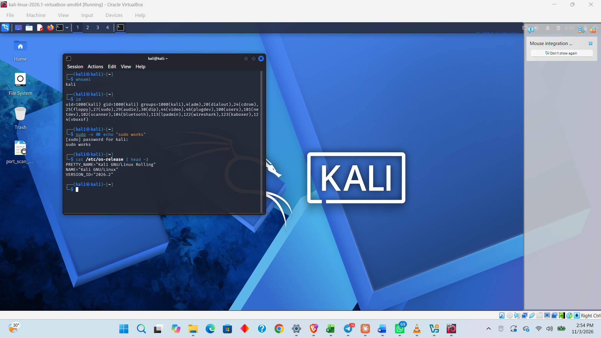
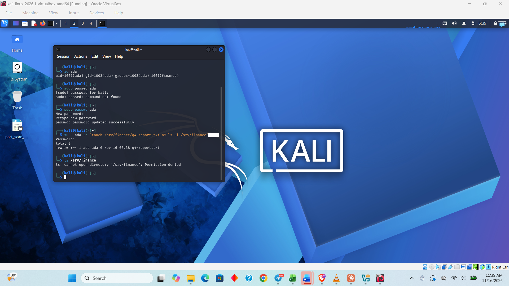
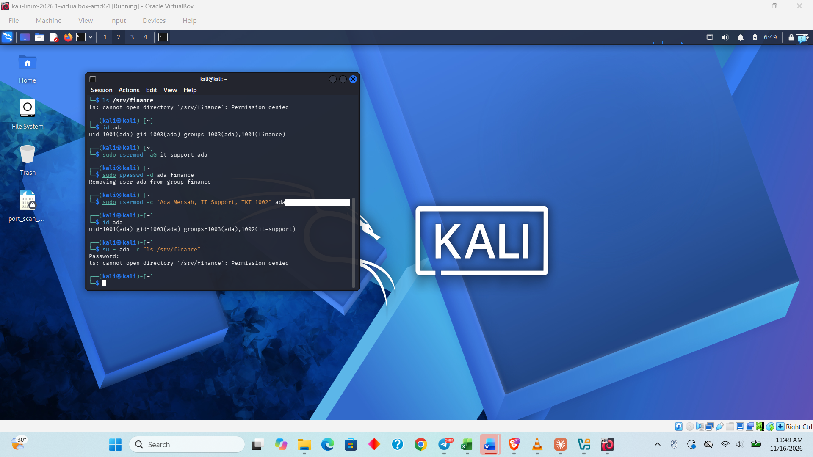
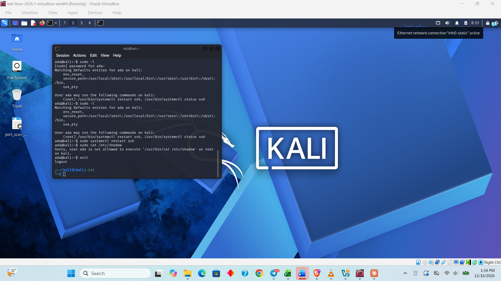
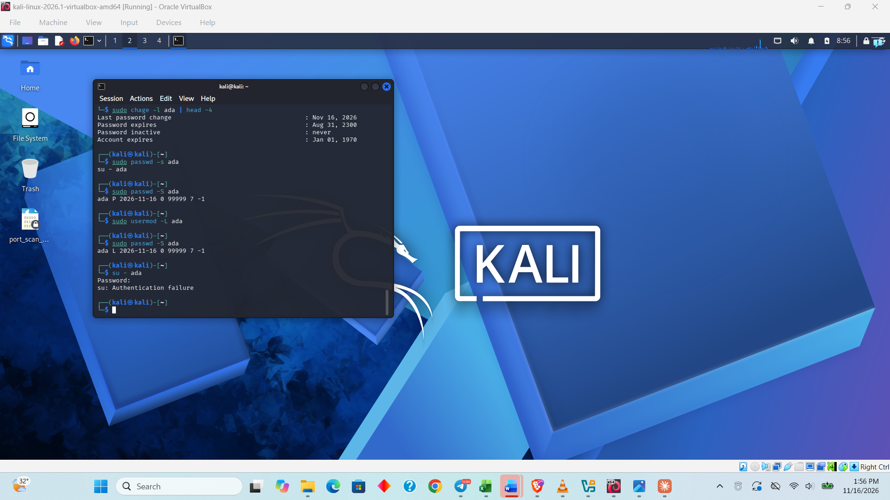
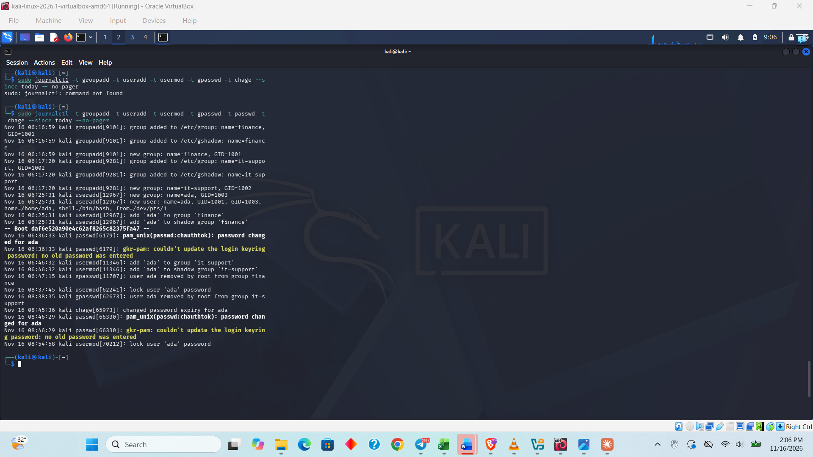
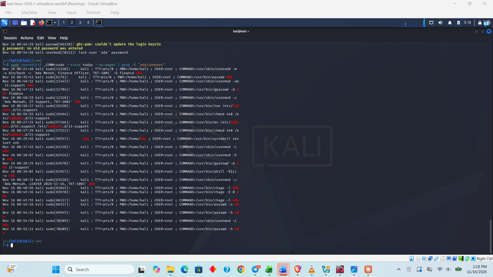
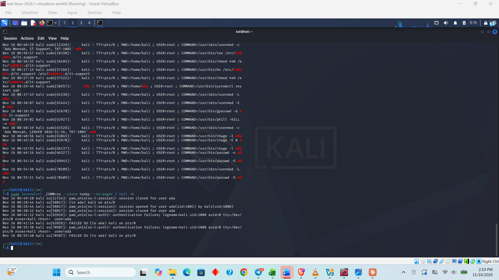
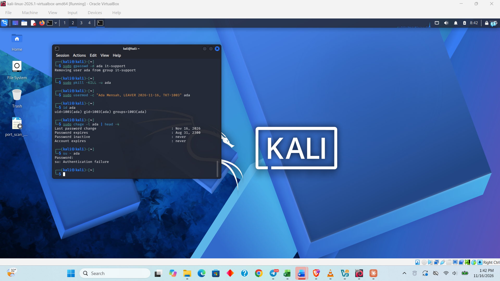

# Project 0: Identity Lifecycle (Joiner-Mover-Leaver) on Linux

Hands-on lab simulating how an organisation creates, changes and removes a user's access, applies least privilege to admin rights, and proves every change with logs.

**Part of:** [iam-home-lab](../README.md), my self-built Identity and Access Management portfolio
**Date:** 16 November 2026
**Lab:** Kali Linux 2026.2 (VirtualBox VM)

---

## Goal

Demonstrate the core IAM concepts that every identity platform (Active Directory, Microsoft Entra ID, Okta, SailPoint) is built on:

- **Authentication vs authorization**: proving who you are vs what you may do
- **Role-based access control (RBAC)**: access granted through roles (groups), not individuals
- **The identity lifecycle (JML)**: joiner, mover and leaver, without privilege creep or orphaned accounts
- **Least privilege**: admin rights limited to exactly what a job needs
- **Accounting**: an audit trail that proves who did what, and when

## Scenario

Ada Mensah, a fictional employee, goes through a full employment lifecycle. Each stage is driven by an HR ticket, as it would be in a real organisation.

| Ticket | Event | Required access change |
| --- | --- | --- |
| TKT-1001 | Ada joins as a Finance Officer | Account + Finance role + access to the Finance folder |
| TKT-1002 | Ada moves to IT Support | Add IT Support role, **remove** Finance access |
| TKT-1003 | Ada leaves the company | Lock, expire, remove all roles, end sessions, keep the account for audit |

---

## What I built

### 0. Lab check
Confirmed my admin identity (`uid=1000`, member of the `sudo` group) before starting. Membership of that group is what grants admin rights, so even the lab account itself works through RBAC.



### 1. Roles and a protected resource
Groups act as roles. The Finance folder is restricted to the `finance` role only (`770`: owner and group full access, everyone else nothing).

```bash
sudo groupadd finance
sudo groupadd it-support
sudo mkdir -p /srv/finance
sudo chown root:finance /srv/finance
sudo chmod 770 /srv/finance
```

### 2. Joiner (TKT-1001)
Ada's account is created with her birthright access through the Finance role, and the ticket number is stamped on the account for traceability.

```bash
sudo useradd -m -s /bin/bash -c "Ada Mensah, Finance Officer, TKT-1001" -G finance ada
sudo passwd ada
```

**Test:** Ada (authenticated and authorized) can create a file in `/srv/finance`. My own admin account gets `Permission denied`: authenticated but **not authorized**.



### 3. Mover (TKT-1002)
New access added **and old access removed**, to prevent privilege creep.

```bash
sudo usermod -aG it-support ada      # -a appends; without it, all other groups are replaced
sudo gpasswd -d ada finance
sudo usermod -c "Ada Mensah, IT Support, TKT-1002" ada
```

**Test:** Ada can no longer open `/srv/finance`. The old access is proven gone, not just assumed gone.



### 4. Least privilege for admin rights
IT Support needs to restart the SSH service, and nothing else. Instead of full `sudo`, the role gets exactly two commands:

```bash
echo '%it-support ALL=(root) /usr/bin/systemctl restart ssh, /usr/bin/systemctl status ssh' | sudo tee /etc/sudoers.d/it-support
sudo chmod 440 /etc/sudoers.d/it-support
sudo visudo -c     # validate syntax and confirm the rule is loaded
```

**Test:** Ada can restart SSH. Her attempt to read `/etc/shadow` (password hashes) is refused: `Sorry, user ada is not allowed to execute '/usr/bin/cat /etc/shadow' as root`.



### 5. Leaver (TKT-1003)
The account is disabled, not deleted, so it stays available for audit or investigation during a retention period.

```bash
sudo usermod -L ada                  # lock the password
sudo chage -E 0 ada                  # expire the account (also blocks SSH keys, which a password lock alone does not)
sudo gpasswd -d ada it-support       # remove role; her sudo rights disappear automatically (RBAC)
sudo pkill -KILL -u ada              # end any active sessions
sudo usermod -c "Ada Mensah, LEAVER 2026-11-16, TKT-1003" ada
```

**Verified:** `passwd -S ada` shows `L` (locked), `chage -l ada` shows `Account expires: Jan 01, 1970` (expired), and `su - ada` gives `Authentication failure`.



### 6. Accounting: proving every change from logs
```bash
sudo journalctl -t groupadd -t useradd -t usermod -t gpasswd -t passwd -t chage --since today --no-pager
sudo journalctl _COMM=sudo --since today --no-pager | grep -E "ada|sudoers"
sudo journalctl _COMM=su --since today --no-pager | tail -8
```





**Audit timeline reconstructed from the logs:**

| Time | Event | Stage |
| --- | --- | --- |
| 06:16-06:17 | `finance` and `it-support` groups created | Setup |
| 06:25:31 | User `ada` (UID 1001) created, added to `finance` | Joiner |
| 06:46:32 | `ada` added to `it-support` | Mover |
| 06:47:15 | `ada` removed from `finance` | Mover |
| 08:29:46 | `ada` ran `sudo systemctl restart ssh` (permitted) | Least privilege |
| 08:37:45 | `ada` password locked | Leaver |
| 08:38:35 | `ada` removed from `it-support` | Leaver |
| 08:45:36 | `ada` account expired | Leaver |
| 08:46:29 | **Unexpected password change on `ada`** | Incident (see below) |
| 08:54:58 | `ada` password re-locked | Remediation |
| 08:41 and 08:55 | `FAILED SU (to ada)`: login attempts refused | Proof of removal |

---

## Problems I hit and how I fixed them

These were real mistakes during the lab. Each one mirrors a failure that happens in production IAM.

**1. A sudo rule that silently did nothing.**
I saved the rule as `/etc/sudoers.d/it.support` (with a dot). `sudo` silently ignores files in `sudoers.d` whose names contain a dot, with no error or warning. I spotted it because `visudo -c` listed the other rule files but not mine. Fixed by renaming it to `it-support`.
*Lesson: never assume an access rule is active. Verify that it loaded.*

**2. A leaver whose account was never expired.**
After the leaver steps, `chage -l` still showed `Account expires: never`. The sudo log showed the cause: I had run `usermod -E 0 ada`, but `usermod` has no `-E` option, so the command failed. The password lock alone blocked logins, but an SSH key would still have worked. Fixed with `chage -E 0 ada`.
*Lesson: check the evidence against the checklist. "Login refused" is not the same as "every control is in place".*


**3. An accidental password change that unlocked a leaver's account.**
I typed `passwd -s` (read a new password from input) instead of `passwd -S` (show status). The next pasted line became a new password, and setting it **removed the lock**. Status changed from `L` to `P`. The account expiry still blocked logins, so there was no exposure, but I re-locked it. The identity log recorded the unexpected change at 08:46:29, eight minutes after the account was locked. In a real organisation that line would trigger an investigation.
*Lesson: one wrong letter turned a read-only command into a change, with no warning. Run privileged commands one at a time and read every output. The password involved belonged to a disabled lab account.*

**4. A 43-second window of combined access.**
During the move, Ada held both `finance` and `it-support` from 06:46:32 to 06:47:15. In a bank, even a brief overlap of conflicting roles is a segregation-of-duties risk.
*Lesson: remove old access before granting new access, or make the move one automated step.*

**5. Not everything is logged by default.**
The `usermod -c` comment changes (ticket numbers) left no entry in the identity log.
*Lesson: audit coverage has to be checked, not assumed.*

---

## Skills demonstrated

- Identity lifecycle management (joiner, mover, leaver)
- Role-based access control and least privilege
- Privileged access restriction with scoped `sudo` rules
- Account deprovisioning: lock, expire, remove roles, end sessions, retain for audit
- Audit log analysis and root-cause investigation with `journalctl`
- Change traceability through ticket references

## How this maps to enterprise IAM

| In this lab | In Active Directory / Microsoft Entra ID |
| --- | --- |
| Linux groups as roles | Security groups, RBAC role assignments |
| `useradd` with a ticket number | Provisioning from an HR system of record |
| `gpasswd -d` on a move | Removing old group memberships (preventing privilege creep) |
| Scoped `sudoers` rule | Entra PIM, CyberArk, least-privilege admin roles |
| `usermod -L` + `chage -E 0` + `pkill` | Disable account, revoke sessions, block sign-in |
| `journalctl` audit trail | Entra audit and sign-in logs, Windows Security event logs |

## What I would do next in a real organisation

- Drive joiner, mover and leaver automatically from HR records, so no step depends on someone remembering
- Make moves atomic: remove old access and add new access in one step
- Send identity and sudo logs to a SIEM, with alerts on changes to locked or leaver accounts
- Run periodic access reviews to catch privilege creep and dormant accounts
